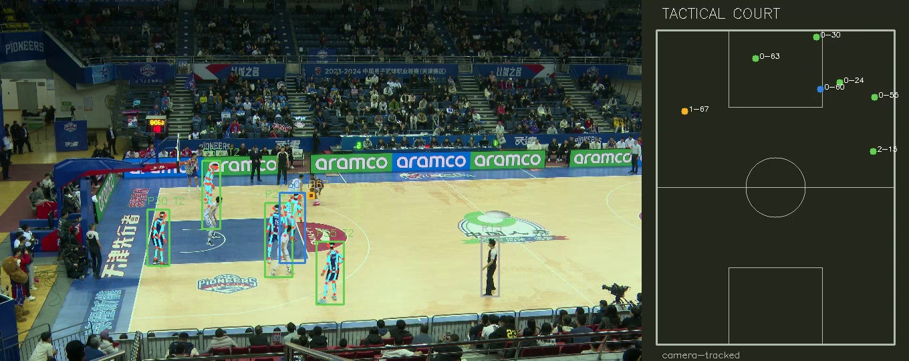

# Basketball Player Tracking and Pose Estimation on reComputer RK3576

A local English FastAPI application using the original [PoseVision](https://github.com/Yingbo-Jiao/PoseVision) `input/sample2.mp4`, unchanged custom `yolo_detection/best.pt`, and original pretrained RTMPose-s checkpoint. No retraining, synthetic detections, synthetic keypoints or invented court positions.

## Pipeline

| Component | Implementation | Device |
| --- | --- | --- |
| Detection | Original four-class YOLO11n, 640 × 640 RGB letterbox; player/referee/other confidence 0.30, ball 0.12; DFL and per-class NMS; adaptive high-resolution ball tiles | RK3576 NPU, FP16 RKNN |
| Tracking | DeepSORT Kalman filter, matching cascade, cosine appearance association; separate player/ball/referee trackers | CPU |
| Appearance | DeepSORT's bundled pretrained ImageNet MobileNetV2 bottleneck, unchanged weights, 1280-dimensional embeddings | RK3576 NPU FP16; explicit CPU alternative |
| Teams | Two torso saturation/value clusters, per-ID vote stabilization, unknown until sufficient separation | CPU |
| Pose | Exact RTMPose-s `fcb2599b_20230126` checkpoint, 192 × 256 RGB, 17 COCO joints, SimCC split ratio 2 | RK3576 NPU backbone + ONNX CPU RTMCC/SimCC head |
| Court | Four corresponding floor/reference points, manual homography, floor optical-flow/RANSAC camera compensation, player footpoint projection | OpenCV CPU |
| Output | Detection boxes, confirmed IDs, skeletons and tactical court; JSONL trace and H.264 MP4 | CPU |

The actual checkpoint metadata identifies class 0 `player`, 1 `ball`, 2 `referee`, 3 `others`. Class 3 is displayed as a detection and excluded from tracking/pose. All detected players with confirmed tracks receive pose inference every frame. Missed detections do not produce fabricated skeletons. Unconfirmed detections appear as thin gray boxes for the first few frames; confirmed tracks carry labels. Tracker-only predicted locations are excluded from the visible output and tactical projection.

**Compatibility:** the default pose backend is a verified NPU backbone + CPU head. The experimental full RTMPose RKNN returns all-zero outputs on this board and is not used by the WebUI. See the detailed limitation and alternative below.

## Optimized deployment

The complete original 1500-frame sample now finishes in **930.42 seconds at 1.612 end-to-end FPS**, compared with 1842.84 seconds / 0.814 FPS before optimization: **1.98× faster**. Every frame and all stages remain enabled. All 11,366 detections match the previous run; matched keypoint coordinates differ by 0.0003 original-image pixels on average. DeepSORT confirmations can change slightly (8759 versus 8760 pose observations).

The update adds NPU ReID, measured per-model NPU core selection, bounded CPU thread pools and DeepSORT galleries, score-first DFL decoding, and ordered video prefetch/encoding queues. The faster INT8 detector candidate failed the quality gate and remains excluded. This is still offline processing, not real-time 25/50 FPS.

[Full optimization measurements and limitations](docs/PERFORMANCE.md) · [Open the optimized saved result](http://192.168.3.120:8093/?job=e018f8f89ece407390e0eff82810b569)



## Original baseline complete sample

All 1500 original 4K frames completed without skipping. The H.264 result is 1360 × 540, 50 FPS, 30 seconds, and every output frame was decoded successfully.

| Metric | Actual full-run value |
| --- | --- |
| YOLO NPU calls/s | 17.83 (four calls per video frame) |
| YOLO NPU video-frame equivalent FPS | 4.46 |
| RTMPose backbone NPU crops/s | 89.66 |
| Combined NPU video-frame equivalent FPS | 3.45 |
| End-to-end video FPS | **0.814** |
| Total processing time | 1842.84 seconds |

The trace contains 992 frames with ball detections, 8760 pose observations and 9812 mapped track observations. These counts are not a ground-truth accuracy evaluation. Camera registration remained active for all 1500 frames. Full evidence, limitations and conversion parity are in [docs/VALIDATION.md](docs/VALIDATION.md).


## Start on the verified board

The installed project is `/home/seeed/rk3576-posevision`. With the existing device environment:

```bash
cd /home/seeed/rk3576-posevision
bash run_board.sh
```

Open [http://192.168.3.120:8093](http://192.168.3.120:8093). The running server accepts one inference job at a time; another run returns HTTP 409. Use one Uvicorn worker. Do not benchmark the CLI concurrently with the WebUI or other NPU workloads. The default Python is `/home/seeed/rockchip-yolo11-quant-benchmark/.venv/bin/python`; `.deps/` contains isolated WebUI/DeepSORT dependencies. Override `BASKETBALL_PYTHON` and `BASKETBALL_PORT` when needed.

For a clean Linux ARM64 board with Python 3.11, a working RK3576 NPU driver and vendor runtime:

```bash
sudo apt-get update
sudo apt-get install -y git python3.11-venv
git clone https://github.com/inteintegrity/rk3576-posevision.git
cd rk3576-posevision
bash setup_board.sh
.venv/bin/python tools/download_sample.py --small-ranges
BASKETBALL_PYTHON="$PWD/.venv/bin/python" bash run_board.sh
```

`setup_board.sh` installs the official RKNN Lite2 2.3.2 ARM64 wheel. A compatible vendor NPU kernel driver and `librknnrt.so` are prerequisites; pip cannot install a kernel driver. The verified device uses kernel `6.1.115-vendor-seeed-rk3576`, driver 0.9.8, vendor runtime 2.3.0 and Lite2 2.3.2. YOLO and the hybrid pose backbone have been validated with that combination. The full RTMPose RKNN loads but produces invalid all-zero outputs; see the compatibility section. The runtime's static-model dynamic-range query warning is expected; model parity is checked separately.

## Use the WebUI

1. Choose **Use original sample** or upload an MP4 (up to 512 MB).
2. To enable court mapping, select four visible floor landmarks in perimeter order on the first video frame. Select the same four locations in the same order on the full-court reference. The quadrilaterals must be convex and nondegenerate. Reset all points to skip mapping. Partial courts work when corresponding landmarks are placed at their actual full-court locations.
3. Select **NPU backbone + CPU pose head** for pose, then **Analyze video**. **Off** runs detection/tracking only. **ONNX CPU** is an explicit troubleshooting alternative; it is never selected automatically.
4. Inspect the genuine live preview and measured rates. At completion, play/seek the MP4, download it, or open **Performance report** / **Frame data**.

Calibration belongs to the current job, not every uploaded video. New uploads begin uncalibrated. A missing calibration disables positional dots and records `court_position: null`; the reference court explicitly says **Calibration required**. There is no guessed calibration. Input-normalized coordinates and output court-normalized coordinates are saved with each report.

## Timing definitions

- **Detection NPU FPS** = detection calls / cumulative blocking RKNN inference API time, including the first real call. High-resolution footage uses one full-frame call plus overlapping ball-tile calls (four calls per frame on sample2). This rate is calls/s. `detection_npu_frame_fps` in JSON gives processed video frames divided by total detection NPU time. Preprocessing/DFL/NMS are excluded.
- **Pose NPU backbone FPS** = person crops / cumulative blocking pose backbone RKNN inference API time. The unchanged pose attention/SimCC head runs on CPU and is included in end-to-end time, with its own time in JSON. This is crops per second, not video frames per second; a frame with ten players requires ten pose calls.
- **ReID NPU FPS** = appearance crops / cumulative blocking ReID RKNN API time.
- **NPU pipeline FPS** in JSON = processed video frames / (detection NPU API time + pose backbone NPU API time + ReID NPU API time). CPU pose time is excluded when the explicit CPU pose option is used.
- **End-to-end FPS** = video frames / wall time from model initialization through video decode, preprocessing, CPU ReID/tracking, teams, pose, court mapping, rendering, JSON writing, MP4 encoding and finalization. Upload and queue wait are excluded. During processing it is provisional; the final report includes encoder flush.

The saved MP4 retains the source frame rate and duration, with no frame skipping in normal runs. Output width is at most 960 video pixels plus a 400-pixel court panel; this is rendering resolution, not inference throughput. Audio is omitted. Video playback FPS does not represent inference FPS. Actual measurements and validation artifacts are recorded in [docs/VALIDATION.md](docs/VALIDATION.md).

## Performance controls

The optimized defaults use NPU ReID, a 100-feature DeepSORT gallery, one BLAS thread and two OpenCV threads. Detector and ReID use both RK3576 NPU cores; pose keeps automatic scheduling because it was faster in measured tests. Overrides are `BASKETBALL_CPU_THREADS`, `BASKETBALL_DETECTOR_CORES`, `BASKETBALL_REID_CORES`, `BASKETBALL_REID=onnx`, and `BASKETBALL_DETECTOR=/path/to/model.rknn`. There is no automatic CPU fallback. The experimental INT8 detector failed the quality comparison and is not enabled. See [PERFORMANCE.md](docs/PERFORMANCE.md) for complete before/after measurements.

## CLI and validation

```bash
export PYTHONPATH="$PWD/.deps${PYTHONPATH:+:$PYTHONPATH}"
PYTHON=/home/seeed/rockchip-yolo11-quant-benchmark/.venv/bin/python
$PYTHON tools/environment_report.py
# Optional parity check: first generate models/detector.onnx using the export steps below.
$PYTHON tools/validate_models.py
$PYTHON -m basketball.pipeline --video upstream/input/sample2.mp4 \
  --output outputs/detection-check --pose off --max-frames 100
$PYTHON -m basketball.pipeline --video upstream/input/sample2.mp4 \
  --output outputs/full-sample --pose hybrid --calibration docs/sample2-calibration.json
$PYTHON -m unittest discover -s tests -v
```

`--max-frames` is only for explicit validation clips. Such reports set `partial_run: true`. Omit `--calibration` to disable projection. The calibration JSON schema is:

```json
{"image_points": [[0.1, 0.2], [0.8, 0.2], [0.9, 0.9], [0.05, 0.8]],
 "court_points": [[0, 0], [1, 0], [1, 1], [0, 1]]}
```

These numbers demonstrate the schema only and are **not** sample-video calibration. Use measured floor correspondences. `tools/validate_models.py` checks real first-frame detector tensor cosine similarity and pose coordinate differences against ONNX Runtime on the same board. It checks regression tensor cosine above 0.98, decoded class-matched detections with IoU above 0.95 and confidence difference below 0.05, and mean valid-keypoint error below 5 pixels. All nine tensor cosines are retained for diagnosis; near-zero class probabilities and unused score-sum tensors can have lower cosine after FP16 conversion. This checks conversion parity, not dataset detection/pose accuracy.

## Reproduce model conversion (Linux x86_64)

The export requirements intentionally skip unused MMPose training dependencies such as Chumpy; the two install commands below are required. Use Python 3.10 and the official [RKNN Toolkit2 2.3.2](https://github.com/airockchip/rknn-toolkit2/tree/v2.3.2) wheel for your Linux/Python version. The already installed conversion environment on the development PC is `/home/seeed/.venvs/rknn-toolkit2-2.3.2/bin/python` in Ubuntu 22.04 WSL.

```bash
python3.10 -m venv .convert
source .convert/bin/activate
pip install torch==2.4.0 torchvision==0.19.0 --index-url https://download.pytorch.org/whl/cpu
pip install --no-deps -r requirements-export.txt
pip install -r requirements-export-deps.txt
# Install Rockchip's rknn_toolkit2-2.3.2 CPython 3.10 Linux x86_64 wheel.
```

The pinned upstream revision is in `upstream_revision.json`. Original source, checkpoints and footage are fetched from upstream instead of being committed. `fetch_source.py` restores the required source/configuration and custom checkpoint and verifies Git blob hashes. Runtime models are included in `models/`. To restore the original video with resumable downloads and strict original Git-blob verification:

```bash
python tools/download_sample.py
```

The expected video size is 95,708,286 bytes and Git blob SHA-1 is `6e47c96313a27f3d0e7268d402c69646fc92cb4b`. The custom YOLO checkpoint SHA-256 is `fde2d88f0e51d62bff61b3176f5bf4c76ec6001523d581365de8bdc9d6527eb6`. Run `python fetch_source.py` to restore the unchanged original custom checkpoint at `upstream/yolo_detection/best.pt`.

```bash
python fetch_source.py
curl -fL https://download.openmmlab.com/mmpose/v1/projects/rtmposev1/rtmpose-s_simcc-aic-coco_pt-aic-coco_420e-256x192-fcb2599b_20230126.pth -o rtmpose.pth
python tools/export_yolo.py
python tools/export_pose.py
python tools/export_reid.py
python tools/convert_rknn.py detector
python tools/convert_rknn.py pose_backbone
python tools/convert_rknn.py reid
# Optional compatibility experiment; fails output validation on the verified board:
python tools/convert_rknn.py pose
```

YOLO's weights remain unchanged. Only the export head is exposed as three raw DFL regression/classification scales; decoding/NMS run on CPU, following Rockchip's raw-head contract. RTMPose exports CSPNeXt + RTMCCHead with strict checkpoint loading, no flip augmentation and no training. The CPU exporter installs a fail-fast placeholder for unused compiled MMCV extensions because these models only need standard PyTorch operations. Invoking any compiled op fails explicitly; no operator output is synthesized. RKNN compilation uses static shapes, `target_platform='rk3576'`, FP16, and no quantization dataset.

Normalization happens exactly once inside the RKNN graph: detector RGB `/255`; pose and ReID RGB `(pixel - [123.675,116.28,103.53]) / [58.395,57.12,57.375]`. Runtime inputs are uint8 NHWC. ONNX reference inputs are float32 NCHW with equivalent host normalization. Pose uses an aspect-preserving 1.25 padded affine crop and inverse-affine SimCC coordinate mapping. `.json` manifests document hashes, shapes and normalization; `.build.json` records RKNN build times and SHA-256. Measured build-only times on this PC were 2.56 seconds (detector) and 2.10 seconds (experimental full pose), and 1.35 seconds (working pose backbone); downloads and ONNX export are excluded.

## Limits and alternatives

YOLO converts and runs correctly as RKNN. **Full RTMPose converts and loads, but its two SimCC outputs are all zero on the verified toolchain/runtime. It is not a working deployment.** The exact failing operator was not isolated; the full-graph numerical/compiler/runtime incompatibility is documented in `models/pose.rknn.validation.json` and `docs/model_parity.json`. The default verified alternative runs the original CSPNeXt backbone as `pose_backbone.rknn` and the unchanged RTMCC/SimCC head as `pose_head.onnx` on CPU. Weight loading is strict and there is no retraining. The WebUI does not offer the invalid full-graph model. The CLI experimental `--pose rknn` fails explicitly if outputs are all zero or nonfinite. If the NPU/driver is unavailable, the application fails visibly; it never substitutes fabricated output. Pose can be deliberately set to ONNX CPU or disabled to keep NPU detection/DeepSORT available. DeepSORT's appearance network now defaults to validated FP16 RKNN on NPU. Set `BASKETBALL_REID=onnx` for the explicit CPU alternative. Its NPU time/calls are reported separately and included in the optimized combined NPU metric.

The full-frame-only detector missed the ball in the tested 4K footage. The final pipeline therefore also runs the same detector on overlapping, up-to-1440-pixel original-resolution square tiles in a vertical band centered on detected players/referees (or at 60% image height when no humans are detected). Only ball detections from tiles are retained; they are transformed back to original pixels and merged with class-wise NMS at IoU 0.5. The ball threshold is 0.12, while other classes retain 0.30. This increases NPU calls and can increase false positives; balls outside the adaptive vertical band or severely occluded/blurred balls can still be missed. The tile policy is fixed and performs real inference every frame. Traces retain genuine misses; no ball interpolation is painted as a detection. DeepSORT IDs can switch after occlusion and are not jersey-number identities. Team IDs are anonymous color groups; similarly saturated/value jerseys, referees, lighting and spectators can confuse classification. Pose quality depends on detector crop size and occlusions; only confidence-qualified joints/edges are drawn.

Court mapping assumes a planar floor. Between frames, floor features are tracked with forward/backward Lucas–Kanade flow and RANSAC homography; player/ball detection regions are excluded. The initial manual homography is updated for camera movement. This can drift and is not a learned court-line detector. Fewer than 12 reliable inliers, a low inlier ratio, an abrupt scale change or failed registration disables mapping for the rest of that job and visibly reports **Camera tracking lost**. For a camera cut, upload a clip beginning at the new viewpoint and calibrate a new job. Airborne ball image centers do not lie on the floor and produce approximate projections. Court dots outside the normalized full-court bounds are withheld. Four internal floor landmarks (such as paint corners) can calibrate the full court through planar extrapolation. No possession/event recognition, 3D ball position, MOTA or dataset AP claims are made.

## Development helpers

`python -m pip install -r requirements-dev.txt` installs the optional HTTP/SSH helper dependencies. The FastAPI runtime only requires `requirements.txt`. Generated calibration images, videos, traces, logs and rejected model binaries remain ignored by Git.

## Files and operation

- `basketball/`: actual RKNN adapters, decoder, DeepSORT/ReID, teams, pose, projection and streaming MP4 pipeline.
- `server.py`, `web/`: English local WebUI, streaming upload, one-job NPU lock, progress, range-capable MP4 responses.
- `models/`: original-weight ONNX exports, FP16 RKNN binaries and conversion manifests.
- `tools/`: conversion, source/sample acquisition, device environment and parity verification scripts. SSH helper takes credentials from environment/agent and does not store passwords.
- `upstream/`: downloaded reference sources, config, custom weights and original sample; ignored by Git.
- `outputs/<job-id>/`: uploaded input, first frame, live preview, result MP4, per-frame JSONL, report and status. Completed jobs persist across service restarts. Interrupted jobs are identified explicitly. Data remains local until you delete it; there is no automatic cleanup. Two-frame bounded decode/encode queues preserve every frame in order.

See [THIRD_PARTY_NOTICES.md](THIRD_PARTY_NOTICES.md) for component attribution and redistribution constraints. The GitHub repository excludes generated videos, uploads, caches, logs, compiler-debug graphs, intermediate detector/backbone ONNX exports, original checkpoints and downloaded upstream files.
