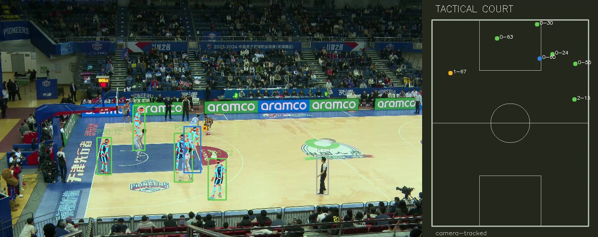

# RK3576 performance optimization

## Complete original-video comparison

Both runs process the unmodified 3840 × 2160, 50 FPS, 1500-frame `sample2.mp4`, with detection, three high-resolution ball tiles per frame, DeepSORT, jersey-color groups, per-confirmed-player hybrid pose, camera compensation, tactical court, JSONL and H.264 output enabled. There is no frame skipping, cached detection replay, interpolated skeleton, reduced detector resolution or disabled stage in the optimized run.

| Measurement | Original | Optimized |
| --- | --- | --- |
| Frames | 1500 | 1500 |
| Total wall time, seconds | 1842.84 | 930.42 |
| End-to-end FPS | 0.814 | **1.612** |
| Detection NPU calls | 6000 | 6000 |
| Detection NPU calls/s | 17.83 | 20.10 |
| Detection frame-equivalent NPU FPS | 4.46 | 5.02 |
| Pose backbone NPU crops/s | 89.66 | 100.28 |
| ReID backend | CPU ONNX | FP16 RKNN NPU |
| ReID NPU crops/s | — | 67.61 |
| Pose observations | 8760 | 8759 |

Measured end-to-end speedup: **1.98×**. This remains an offline analytics pipeline; no real-time 25/50 FPS claim is made. NPU rates measure blocking RKNN API calls. The optimized combined NPU timing also includes ReID, which previously ran on CPU, so its denominator represents more work than the old combined NPU metric.

## Changes retained

1. Move unchanged pretrained MobileNetV2 appearance inference to FP16 RKNN. Real-crop feature parity versus ONNX CPU has minimum cosine 0.999836. Explicit CPU fallback is `BASKETBALL_REID=onnx`; its inputs are batched across classes once per frame with float32 in-place normalization.
2. Bound BLAS to one thread, OpenCV to two threads, and keep ONNX Runtime intra-op threads at two. This reduces synchronization on small Kalman/cosine operations. `BASKETBALL_CPU_THREADS` controls OpenCV threads.
3. Bound DeepSORT's descriptor gallery to 100 features per identity. IDs can differ after occlusion; agreement with previous IDs is not a ground-truth tracking metric.
4. Use both RK3576 NPU cores for detector and ReID, following same-input latency and identical-output tests. Keep automatic scheduling for pose, since dual-core execution was slower there. Overrides are `BASKETBALL_DETECTOR_CORES=0` and `BASKETBALL_REID_CORES=0`.
5. Apply the class confidence gate before DFL softmax/box decoding. Low-score grid cells cannot survive this gate, so computing their boxes was redundant. The score threshold, NMS policy and model weights are unchanged. Real-frame decoder checks have maximum coordinate difference below 0.001 original-image pixels, with identical scores/classes.
6. Prefetch decode and drain the encoder through ordered two-frame queues. Backpressure bounds memory; frames are never discarded. Eight real source frames matched sequential decode hashes exactly, and encoder drain preserved all frames. FFmpeg encoding is bounded to two threads.
7. Add stage wall timers, ReID NPU counters, model/core selection and queue timing to reports. Video worker times overlap main-thread work and must not be added to the main-thread stage sum.

## Profiling evidence

The initial same-window profile (source frames 500–599) took 134.00 seconds. Tracking/ReID consumed 67.66 seconds, detection 35.60 seconds and pose 14.18 seconds. An intermediate optimized profile, before the final score-first DFL change, took 75.83 seconds; tracking/ReID fell to 19.27 seconds. See `optimization-before.json`, `optimization-window-final.json` and `optimization-window-agreement.json`. The final full-video numbers above include the later DFL optimization and court compensation.

Final main-thread stage wall times (seconds):

```json
{
  "initialization": 1.4753491149749607,
  "decode_wait": 1.5506104957894422,
  "detection": 376.5223816080834,
  "tracking_reid": 235.794960872503,
  "teams": 5.685657956870273,
  "pose": 174.2568612866453,
  "camera_projection": 75.02938020438887,
  "trace_json": 1.452520415536128,
  "render": 24.539311301370617,
  "encoder_submit": 0.16093509591883048,
  "preview": 26.620170302514452,
  "encoder_finalize": 0.12291080300929025
}
```

Decode worker time: 88.51 s; main-thread decode waiting: 0.05 s; encoder worker write time: 17.56 s. These worker times overlap other work.

## Quality and integrity checks

The final full trace is compared with the previous real inference, independent of track numbering. Detection retention at IoU ≥ 0.5: `{"0": 1.0, "1": 1.0, "2": 1.0, "3": 1.0}`; mean matched IoU: 0.99999859. Compared valid joints: 141267; mean coordinate difference: 0.0003 original-image pixels. This measures baseline agreement, not ground-truth AP/MOTA/PCK.

Ball-positive frames: 992. Mapping status counts: `{"calibrated": 1, "camera-tracked": 1499}`. Output verification decoded all 1500 frames: H.264, 1360 × 540, 50 FPS, 30 seconds. Per-track confirmations and IDs can change because appearance inference precision and gallery history change; pose is still computed for every currently confirmed player.

## Rejected experiment and remaining limits

The INT8 detector candidate was faster (32.80 calls/s versus 16.97 FP16 in that held-out comparison), but retained only about 67.7% of FP16 player detections and 66.7% of referee detections. It failed the quality gate and is **not** enabled or shipped as a runtime model. The experiment used 128 real calibration images and no retraining; see `int8-evaluation.json`.

Full RTMPose RKNN still produces invalid outputs on this runtime; the verified NPU-backbone/CPU-head split remains. Hardware MPP/RGA video processing is **not enabled**: device nodes exist, but no usable MPP/RGA userspace codec stack was found in the inspected environment. This update keeps software video codecs and overlaps their work. Further acceleration would require separately validated codec integration, model batching or native runtime work; no unmeasured gain is promised.

## Reproduce and inspect

```bash
python -m pip install -r requirements.txt
python -m basketball.pipeline --output outputs/optimized-check --pose hybrid --calibration docs/sample2-calibration.json
# Optional explicit CPU appearance alternative:
BASKETBALL_REID=onnx python -m basketball.pipeline --output outputs/cpu-reid-check --pose hybrid
```

To rebuild the new appearance RKNN on the documented Linux conversion host: `python tools/export_reid.py` then `python tools/convert_rknn.py reid`. Full current metrics are `optimized-full-report.json`; integrity and agreement are `optimized-video-validation.json` and `optimized-full-agreement.json`.

[Open the optimized saved WebUI job](http://192.168.3.120:8093/?job=e018f8f89ece407390e0eff82810b569).


